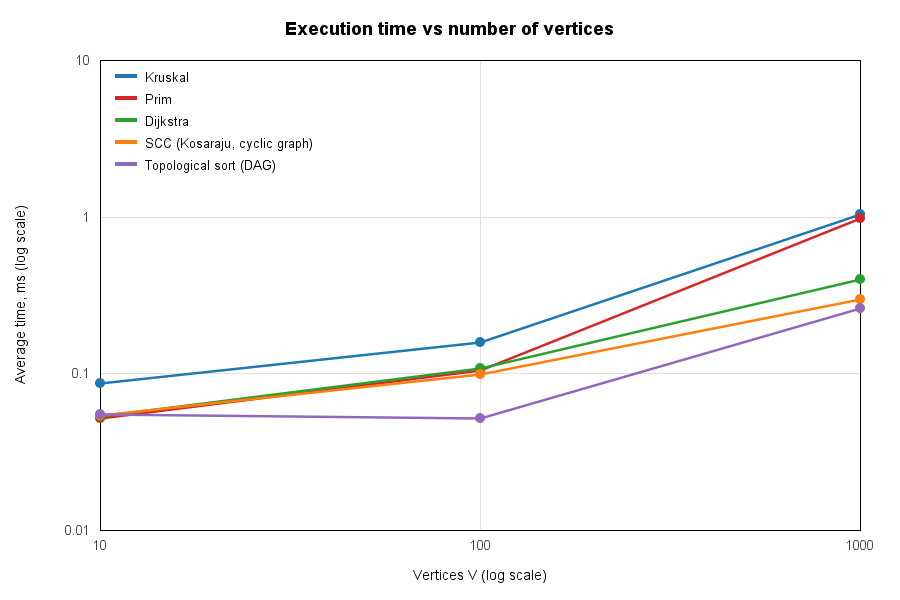
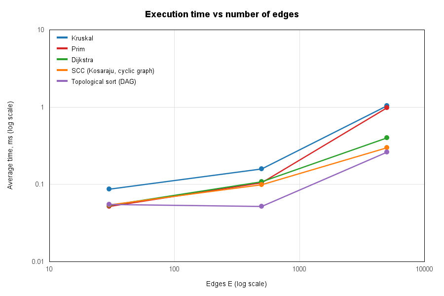
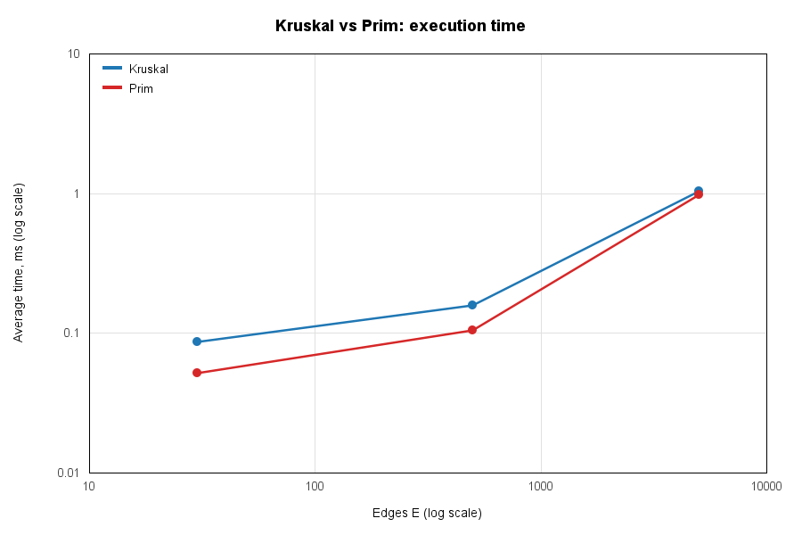
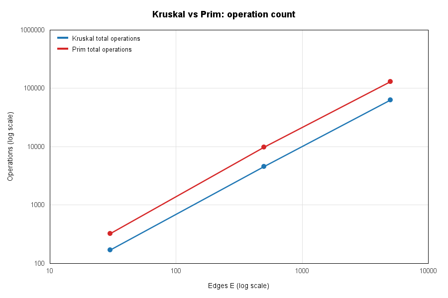
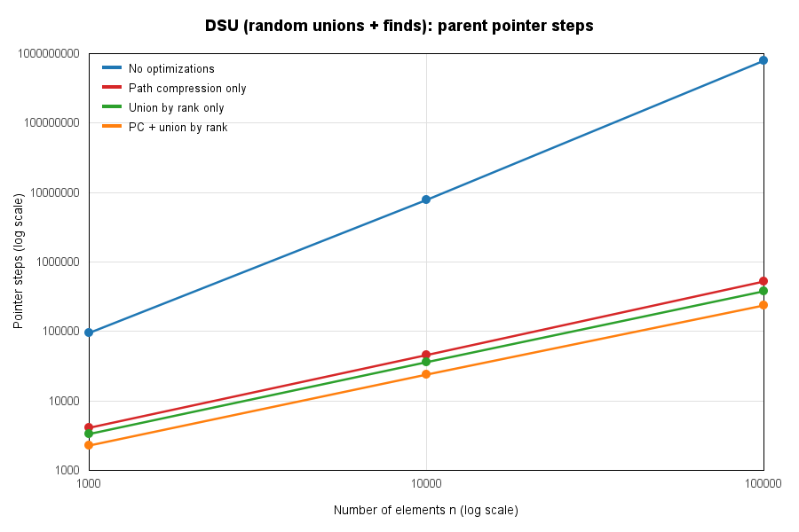

# Assignment 3 - Smart City Infrastructure and Route Planning

In this assignment I made a Java program where a city is a graph, and I used graph algorithms for:

- **Infrastructure planning** - the cheapest road network that connects all districts (MST, Kruskal and Prim).
- **Connectivity analysis** - one-way streets and service dependencies (SCC with Kosaraju, topological order with Kahn).
- **Route planning** - shortest travel distances from one district (Dijkstra).

Everything is plain Java 17+ (I tested on Java 21), no external libraries. Plots are drawn with Java2D.

---

## Table of Contents

1. [How to Run](#how-to-run)
2. [Overview](#overview)
3. [Implementation](#implementation)
4. [Complexity Analysis](#complexity-analysis)
5. [Experimental Setup](#experimental-setup)
6. [Results](#results)
7. [Comparison and Discussion](#comparison-and-discussion)
8. [Testing](#testing)
9. [Conclusion](#conclusion)

---

## How to Run

Windows:

```bat
run.bat
```

Linux / macOS / Git Bash:

```bash
sh run.sh
```

Or step by step:

```bash
javac -d out $(find src -name "*.java")   # compile
java -cp out tests.AllTests                # 40 tests
java -cp out app.Main                      # demo with district names
java -cp out app.Benchmark                 # experiments -> results/tables and results/plots
```

Benchmark takes about 45 seconds. Most of this time is DSU without optimizations on 100 000 elements.

### Project structure

```
assignment-3/
├── src/
│   ├── graph/          Edge, Graph (adjacency list), GraphGenerator (random graphs with seed)
│   ├── dsu/            DSU (path compression + union by rank, can be turned off)
│   ├── mst/            Kruskal, Prim, MSTResult
│   ├── connectivity/   TopologicalSort (Kahn), KosarajuSCC
│   ├── shortestpath/   Dijkstra
│   ├── app/            Main (demo), Benchmark (experiments), PlotGenerator (png charts)
│   └── tests/          AllTests (correctness tests)
├── results/
│   ├── tables/         mst.md, connectivity.md, dijkstra.md, dsu.md, all_results.csv
│   └── plots/          time_vs_vertices.png, time_vs_edges.png, kruskal_vs_prim_*.png, dsu_optimizations.png
├── run.bat / run.sh
└── README.md
```

---

## Overview

The city is a **weighted graph**:

| Graph element | City meaning |
|---|---|
| Vertex `0..V-1` | District or place (Downtown, Harbor, University, ...) |
| Edge | Road or infrastructure connection |
| Weight | Construction cost (MST) or travel distance (Dijkstra) |
| Undirected graph | Two-way roads (MST, Dijkstra) |
| Directed graph | One-way streets (SCC) or "service A must be built before service B" (topological order) |

**Representation: adjacency list.** `Graph` has `List<List<Edge>>` (outgoing edges of every vertex) and also one list with all edges. Kruskal needs the list of all edges to sort it. Prim, Dijkstra, Kahn and Kosaraju need the adjacency list to go through neighbours in `O(deg(v))`. Undirected road is saved one time in the edge list and two times in the adjacency list (`u->v` and `v->u`). Memory is `O(V + E)`. Adjacency matrix needs `O(V^2)`, for the large graph it is 1 000 000 cells, but there are only 5 000 roads.

Output of the demo (`java -cp out app.Main`), shortened:

```
--- Task 1: Minimum Spanning Tree (road construction cost) ---
Kruskal: weight=35, edges=7, connected=true, components=1
Prim: weight=35, edges=7, connected=true, components=1
Same total weight: true
After adding NewSuburb without roads -> connected = false, components = 2

--- Task 2: Strongly Connected Components (one-way streets) ---
Number of SCCs: 4
  {Downtown, University, Harbor}
  {Airport, OldTown, Industrial}
  {TechPark}
  {Riverside}

--- Task 2: Topological order (service dependencies) ---
DAG: true, build order: [PowerGrid -> WaterSupply -> Telecom -> TrafficLights -> Hospital -> Metro]
After adding Metro -> PowerGrid: DAG = false, vertices on/behind a cycle: {PowerGrid, ..., Metro}

--- Task 3: Dijkstra shortest paths from Downtown (travel distance) ---
  Airport     dist =  19  path: [Downtown -> University -> OldTown -> Riverside -> Airport]
  Industrial  dist =  18  path: [Downtown -> University -> TechPark -> Industrial]
  NewSuburb   unreachable
```

---

## Implementation

### DSU (`dsu/DSU.java`)

- Two arrays: `parent[]` and `rank[]`. `find(x)` goes up to the root, then the second loop makes every vertex on this path point directly to the root (**path compression**). It is done with loops, not recursion, so a long chain can not give stack overflow.
- `union(a, b)` puts the root with smaller rank under the root with bigger rank (**union by rank**). It returns `false` if `a` and `b` are already in one set. Kruskal uses this to skip edges that make a cycle.
- `components()` keeps the number of sets, so we know if the graph is connected.
- Second constructor `DSU(n, pathCompression, unionByRank)` can turn the optimizations off. I use it in the benchmark to see how much they help.
- Counters: `findCalls`, `unionCalls`, `pointerSteps` (how many parent links we followed).

### Kruskal (`mst/Kruskal.java`)

1. Copy the edge list and sort it by weight (comparisons are counted in the comparator).
2. For every edge call `dsu.union(u, v)`. If it returns true, the edge connects two components and goes to the MST.
3. Stop when we have `V-1` edges.
4. `connected = (dsu.components() == 1)`. If the graph is disconnected the result is a **minimum spanning forest**.

### Prim (`mst/Prim.java`)

- **Lazy Prim** with `java.util.PriorityQueue` (binary heap) of edges. Start from vertex 0, push all edges to vertices that are not in the tree, then take the cheapest edge again and again. Old edges (both ends already in the tree) are skipped when we poll them.
- If the queue is empty but some vertices are not visited, the graph is disconnected. Then Prim starts again from the next not visited vertex and counts components, so it also returns a spanning forest. Because of this I can compare Kruskal and Prim on disconnected graphs too.
- Counters: edge examinations, PQ inserts, PQ polls, heap comparisons.

### Topological order (`connectivity/TopologicalSort.java`)

- **Kahn's algorithm**: count in-degrees, put all vertices with in-degree 0 into a queue, then take them one by one and decrease in-degree of their neighbours.
- **Cycle detection**: if less than `V` vertices are in the output, some vertices never got in-degree 0, so they are on a cycle or after a cycle. Then `isDAG = false`, the order is cleared (part of the order is not a correct answer), and `blockedVertices` has the vertices that could not be ordered.
- `isValidOrder(g, order)` checks that every vertex is there one time and `pos[u] < pos[v]` for every edge `u->v`. I use it in tests.

### SCC (`connectivity/KosarajuSCC.java`)

- **Kosaraju's algorithm**: (1) DFS on the graph, save vertices by finish time. (2) DFS on the reversed graph, starting from the vertex that finished last. Every DFS tree in step 2 is one SCC.
- Both DFS are done with my own stack (stack + "next edge" index for every vertex), not recursion, so long paths do not overflow the Java stack.
- Returns the list of components and `componentOf[v]`.
- I chose Kosaraju and not Tarjan because it is easier to explain and check. Both are `O(V+E)`.

### Dijkstra (`shortestpath/Dijkstra.java`)

- `PriorityQueue` (binary heap) of pairs `(distance, vertex)` with **lazy deletion**: one vertex can be in the heap many times, old entries are skipped (`done[u]`). Java `PriorityQueue` has no decrease-key, so this is the usual way.
- `prev[]` keeps the shortest path tree. `pathTo(t)` builds the path from it.
- **Unreachable vertices** keep `dist = INF (Long.MAX_VALUE)`, `isReachable(t)` returns `false` and `pathTo(t)` returns an empty list.
- **Negative weights are not allowed**, the program throws `IllegalArgumentException`, because the answer would be wrong (see below).

#### Why Dijkstra does not work with negative weights

Dijkstra uses this idea: when a vertex with the smallest distance is taken from the heap, its distance is final. Any other path must go through a vertex that is already the same distance or further, and adding edges can only make the path longer. A negative edge breaks this. Example:

```
0 -> 1  (weight 1)
0 -> 2  (weight 3)
2 -> 1  (weight -3)
```

Dijkstra takes vertex 1 first with distance 1 and marks it as final. Later it takes vertex 2 (distance 3) and finds `3 + (-3) = 0 < 1`. But vertex 1 is already done, so the correct distance 0 is lost, or if we update it, the vertices after 1 are not updated. With a negative cycle the shortest path does not even exist. For negative weights we need **Bellman-Ford** (`O(VE)`, it also finds negative cycles). In my tests I use Bellman-Ford to check Dijkstra.

### Graph generator (`graph/GraphGenerator.java`)

All graphs are made with `java.util.Random(seed)`, so the same seed gives the same graph. There are no self loops and no duplicate edges. Weights are random from 1 to 100.

| Generator | How it works | Cycles? |
|---|---|---|
| `connectedUndirected(V, E, seed)` | First random spanning tree: shuffle the vertices and connect every vertex `perm[i]` to a random vertex before it `perm[j], j < i` (V-1 edges, so the graph is **always connected**). Then add random new pairs until there are E edges. | Undirected, used for MST and Dijkstra |
| `randomDAG(V, E, seed)` | Take a random order of vertices and add edges only from earlier to later vertex in this order. | **No cycles** (always) |
| `randomDirected(V, E, seed)` | Random pairs `(u, v)`, `u != v`. | **Has cycles** (with E = 3V-5V like in my experiments, Kahn and SCC found cycles, see Results) |

---

## Complexity Analysis

I assume: **adjacency list**, **binary heap** (`java.util.PriorityQueue`: `O(log n)` insert and poll), `V` = vertices, `E` = edges, `α` = inverse Ackermann function (it is not more than 4 for any real input).

| Algorithm | Time | Extra space | Main part |
|---|---|---|---|
| DSU `find` / `union` (PC + rank) | **O(α(V)) amortized** | O(V) | path length (almost constant) |
| DSU, only union by rank | O(log V) per operation | O(V) | tree height <= log2(V) |
| DSU, only path compression | O(log V) amortized | O(V) | |
| DSU, no optimizations | O(V) per operation (chain) | O(V) | tree can become a list |
| Kruskal | **O(E log E) = O(E log V)** | O(V + E) | sorting edges |
| Prim (lazy, binary heap) | **O(E log E) = O(E log V)** | O(V + E) | heap operations |
| Topological order (Kahn) | **O(V + E)** | O(V) | every vertex in queue one time, every edge read two times |
| SCC (Kosaraju) | **O(V + E)** | O(V + E) | two DFS + reversed graph |
| Dijkstra (lazy, binary heap) | **O((V + E) log V)** | O(V + E) | up to E heap inserts |

**DSU.** Union by rank keeps tree height <= log2(V), because a tree with rank r has at least 2^r nodes. Path compression makes paths flat, so next finds are almost O(1). Together it is amortized O(α(n)) (Tarjan). Without optimizations `union(0,1), union(1,2), ...` makes a chain of length V and `find` costs O(V).

**Kruskal.** Sorting is O(E log E). Then at most E edges × 2 finds = O(E α(V)). E <= V^2, so log E <= 2 log V and O(E log E) = O(E log V). More **edges** means more sorting. More **vertices** only adds DSU memory and almost constant work.

**Prim.** Every edge goes into the heap at most one time (only from the end that joins the tree first) and is polled at most one time. So there are O(E) heap operations with O(log E) each, it is O(E log V). Going through adjacency lists is O(V + E). Time depends mostly on **E**. For dense graphs (E ≈ V^2) array Prim (O(V^2)) or Fibonacci heap (O(E + V log V)) is better.

**Topological order.** Counting in-degrees reads all E edges, every vertex goes in and out of the queue one time, and every edge from an output vertex is read one time, so O(V + E). On a graph with cycle the algorithm stops early, so it can be faster than on a DAG with the same size.

**SCC (Kosaraju).** Two DFS, each visits V vertices and E edges, plus O(V + E) for the reversed graph, so O(V + E). The counters are exactly **2V vertex visits and 2E edge examinations** for every graph (see table).

**Dijkstra.** Every vertex is done one time. Every edge is relaxed at most one time from its done vertex, so at most E successful relaxations and heap inserts, each O(log E) = O(log V). Total O((V + E) log V). For a connected graph E >= V - 1, so it is O(E log V).

---

## Experimental Setup

- **Graph sizes** (like in the task):

| Graph | Vertices (V) | Edges (E) |
|---|---|---|
| Small | 10 | 30 |
| Medium | 100 | 500 |
| Large | 1,000 | 5,000 |

- **Graphs for every size** (seed = **42**):
  - connected undirected graph: Kruskal, Prim, Dijkstra (source = vertex 0);
  - random DAG: topological order (DAG case), SCC;
  - random directed graph with cycles: topological order (cycle case), SCC.
- **Time**: `System.nanoTime()`. For every algorithm and graph there are **200 warm-up runs** (not measured, so JIT can optimize the code first), then **5 measured runs**, and I take the **average**. I call `System.gc()` before every measured run (outside the timer) so garbage collection does not happen during measurement. Results are saved to a `volatile` field so JIT can not delete the work as "unused".
- **Operation counters** are inside the algorithms (edge examinations, comparisons, DSU finds/unions, heap inserts/polls, relaxations). Counts are **always the same**. Time depends on the computer and changes about ±30% between runs for very small times (less than 1 ms).
- **DSU experiment**: 4 variants of path compression (PC) and union by rank (UR) on two workloads:
  - *worst case*: `union(i, i+1)` for all i, then `find(i)` for every element (n = 1 000, 5 000, 10 000);
  - *random*: n random unions, then n random finds (n = 1 000, 10 000, 100 000).
- **Computer**: Windows 11, OpenJDK 21 (Temurin).

---

## Results

All tables are made by `app.Benchmark` and saved in [`results/tables`](results/tables). CSV: [`results/tables/all_results.csv`](results/tables/all_results.csv).

### Kruskal vs Prim: time and MST weight

| Graph | V | E | Kruskal time (ms) | Prim time (ms) | Kruskal weight | Prim weight | Same weight | Connected |
|---|---|---|---|---|---|---|---|---|
| Small | 10 | 30 | 0.0872 | 0.0518 | 134 | 134 | yes | yes |
| Medium | 100 | 500 | 0.1584 | 0.1043 | 1153 | 1153 | yes | yes |
| Large | 1000 | 5000 | 1.0422 | 0.9788 | 12900 | 12900 | yes | yes |

### Kruskal vs Prim: operation counts

| Graph | Kruskal edge exams | Kruskal sort comparisons | Kruskal DSU finds | Kruskal DSU unions | Kruskal total ops | Prim edge exams | Prim PQ inserts | Prim PQ polls | Prim heap comparisons | Prim total ops |
|---|---|---|---|---|---|---|---|---|---|---|
| Small | 15 | 109 | 30 | 15 | 169 | 60 | 30 | 30 | 204 | 324 |
| Medium | 180 | 3839 | 360 | 180 | 4559 | 1000 | 500 | 500 | 7770 | 9770 |
| Large | 3271 | 50394 | 6542 | 3271 | 63478 | 10000 | 5000 | 5000 | 111028 | 131028 |

### Topological order and SCC

| Graph | V | E | Directed graph type | Topo time (ms) | Topo result | Topo edge exams | SCC time (ms) | #SCC | Largest SCC | SCC vertex visits | SCC edge exams |
|---|---|---|---|---|---|---|---|---|---|---|---|
| Small | 10 | 30 | DAG | 0.0546 | valid order | 60 | 0.0834 | 10 | 1 | 20 | 60 |
| Small | 10 | 30 | Random (cyclic) | 0.0178 | cycle detected (10 blocked) | 30 | 0.0540 | 1 | 10 | 20 | 60 |
| Medium | 100 | 500 | DAG | 0.0522 | valid order | 1000 | 0.0826 | 100 | 1 | 200 | 1000 |
| Medium | 100 | 500 | Random (cyclic) | 0.0683 | cycle detected (100 blocked) | 500 | 0.0993 | 1 | 100 | 200 | 1000 |
| Large | 1000 | 5000 | DAG | 0.2605 | valid order | 10000 | 0.6324 | 1000 | 1 | 2000 | 10000 |
| Large | 1000 | 5000 | Random (cyclic) | 0.1231 | cycle detected (990 blocked) | 5054 | 0.2970 | 18 | 983 | 2000 | 10000 |

### Dijkstra

| Graph | V | E | Time (ms) | Reachable | PQ inserts | PQ polls | Edge exams | Relaxations | Heap comparisons | Total ops |
|---|---|---|---|---|---|---|---|---|---|---|
| Small | 10 | 30 | 0.0533 | 10 | 18 | 18 | 60 | 17 | 79 | 175 |
| Medium | 100 | 500 | 0.1076 | 100 | 203 | 203 | 1000 | 202 | 2438 | 3844 |
| Large | 1000 | 5000 | 0.3987 | 1000 | 1933 | 1933 | 10000 | 1932 | 35543 | 49409 |

### DSU: effect of path compression and union by rank

Worst case (chain of unions, then `find` on every element):

| n | Variant | Avg time (ms) | Find calls | Union calls | Parent pointer steps |
|---|---|---|---|---|---|
| 1000 | No optimizations | 0.9213 | 2998 | 999 | 499500 |
| 1000 | Path compression only | 0.0800 | 2998 | 999 | 1997 |
| 1000 | Union by rank only | 0.0749 | 2998 | 999 | 1997 |
| 1000 | PC + union by rank | 0.0792 | 2998 | 999 | 1997 |
| 5000 | No optimizations | 23.2670 | 14998 | 4999 | 12497500 |
| 5000 | Path compression only | 0.0516 | 14998 | 4999 | 9997 |
| 5000 | Union by rank only | 0.0497 | 14998 | 4999 | 9997 |
| 5000 | PC + union by rank | 0.0728 | 14998 | 4999 | 9997 |
| 10000 | No optimizations | 102.8380 | 29998 | 9999 | 49995000 |
| 10000 | Path compression only | 0.1328 | 29998 | 9999 | 19997 |
| 10000 | Union by rank only | 0.1229 | 29998 | 9999 | 19997 |
| 10000 | PC + union by rank | 0.0957 | 29998 | 9999 | 19997 |

Random case (n random unions, then n random finds):

| n | Variant | Avg time (ms) | Find calls | Union calls | Parent pointer steps |
|---|---|---|---|---|---|
| 1000 | No optimizations | 0.3689 | 3000 | 1000 | 95288 |
| 1000 | Path compression only | 0.2123 | 3000 | 1000 | 4118 |
| 1000 | Union by rank only | 0.1914 | 3000 | 1000 | 3351 |
| 1000 | PC + union by rank | 0.2629 | 3000 | 1000 | 2302 |
| 10000 | No optimizations | 14.0005 | 30000 | 10000 | 7817847 |
| 10000 | Path compression only | 0.6402 | 30000 | 10000 | 46063 |
| 10000 | Union by rank only | 0.5848 | 30000 | 10000 | 36295 |
| 10000 | PC + union by rank | 0.6425 | 30000 | 10000 | 23677 |
| 100000 | No optimizations | 4438.8980 | 300000 | 100000 | 784922062 |
| 100000 | Path compression only | 8.3075 | 300000 | 100000 | 522543 |
| 100000 | Union by rank only | 8.3862 | 300000 | 100000 | 383191 |
| 100000 | PC + union by rank | 6.8228 | 300000 | 100000 | 237255 |

### Plots

All plots use **log-log axes**, because sizes grow 10 times between graphs and times are very different. On a log-log plot a straight line with slope 1 means linear growth.

**Time vs number of vertices**



**Time vs number of edges**



**Kruskal vs Prim: time and operation count**





**DSU optimizations (random workload)**



---

## Comparison and Discussion

### Kruskal vs Prim

- **Correctness**: both always give the same MST weight (134, 1153, 12900), like the theory says. If there are many MSTs the edges can be different, but the weight is the same (in the demo the order of edges is different, but weight is 35 for both).
- **Operation counts**: the main cost of Kruskal is sorting. Its comparisons (109, 3 839, 50 394) are close to `E*log2(E)` (147, 4 483, 61 438). Because of the early stop it checked only 3 271 of 5 000 edges on the large graph, and DSU work is small (`2 × checked` finds). Lazy Prim puts every edge into the heap one time (`PQ inserts = E`), and its heap comparisons (111 028) are about 2 times more than Kruskal sort comparisons. So Prim does about **2 times more counted operations**.
- **Time**: but the times are very close (Large: 1.04 ms vs 0.98 ms). One counted comparison is just a cheap int compare. Real time mostly depends on memory access and objects, and both algorithms do it about the same (Kruskal copies and sorts all edges with TimSort, which is cache-friendly; Prim goes through adjacency lists and moves edges through the heap). Both grow like O(E log V). From Medium to Large (10 times more edges) time grows 6.6 times (Kruskal) and 9.4 times (Prim), theory `E log V` gives about 15 times. The difference is because of fixed costs that are big for small inputs.
- **What to use**: Kruskal is easier when edges are already in a list, or when the graph is sparse or disconnected (it gives spanning forest directly). Prim is better for dense graphs with adjacency list or matrix, because it does not sort all edges.

### DSU optimizations

- Without optimizations the chain workload needs `n(n-1)/2` pointer steps (499 500 -> 49 995 000), it is **quadratic**. 10 000 elements already take about 100 ms.
- **Only one optimization** is enough for the chain case: steps go down to `2n - 3` (linear), about **2 500 times less steps and about 1000 times faster** for n = 10 000. Union by rank does not let the chain appear (tree stays like a star). Path compression makes it flat on the first `find`.
- On the random workload with n = 100 000, DSU without optimizations needs **785 million steps (4.4 s)**. Only path compression: 523 k. Only union by rank: 383 k. **Both: 237 k steps (6.8 ms, about 650 times faster)**. Both together give the smallest number of steps for every n, this matches O(α(n)). The time difference between the three optimized variants is small, because for these sizes their trees are already very low.

### SCC

- Counters show exactly **2V vertex visits and 2E edge examinations** for every graph, so the algorithm is linear like expected.
- Time grows with graph size (Small 0.05-0.08 ms -> Large 0.30-0.63 ms). From Medium to Large (10 times more V and E) time grows 3-8 times. For small inputs fixed costs (creating arrays, building the reversed graph, timer resolution) are bigger, so growth looks less than linear there.
- On the large graph SCC on the **DAG** (1000 components with size 1) is slower than on the **cyclic** graph (18 components, one big SCC with 983 vertices), but the counters are the same. The reason is that for the DAG it creates 1 000 separate lists and stacks, and these allocations are not counted as "operations".
- **Structure of random directed graphs**: with E = 3V (Small) the whole graph is one SCC. With E = 5V (Medium, Large) there is one big SCC and some single vertices (Large: 18 SCCs, the biggest has 983 vertices). Random DAGs always have V SCCs with one vertex.

### Topological order

- For every DAG the order was correct (checked with `isValidOrder`). Counters show exactly **2E edge examinations**.
- For every cyclic graph the cycle was found. Kahn's algorithm is **faster on cyclic graphs**: in a strongly connected graph almost no vertex has in-degree 0, so after counting in-degrees it stops almost at once (Large: 5 054 edge examinations vs 10 000 for the DAG; 990 of 1000 vertices are blocked).

### Dijkstra

- Counted operations: 175 -> 3 844 -> 49 409. Theory `E*log2(V)` gives 100 -> 3 322 -> 49 829, it is very close, so it is **O(E log V)**.
- Only about 19% of edge examinations make a relaxation (1 932 of 10 000 on the large graph; undirected road is checked from both ends, so there are 2E examinations), so the heap is much smaller than E. Number of heap inserts is `relaxations + 1` (the source).
- Time grows 2 times (Small -> Medium) and 3.7 times (Medium -> Large). It is less than the growth of operations because small runs mostly depend on fixed overhead.

### Theory vs experiment

- Operation counts match the theory almost exactly (linear `2V`/`2E` for SCC and topological order, `E log E` for Kruskal, `E log V` for Dijkstra, quadratic vs almost linear for DSU).
- Times show the same trend but jump more. When time is less than 1 ms, JIT, CPU cache, memory allocation and timer resolution are as important as the algorithm, so constants hide the difference for Small graphs. The Large graph and the DSU experiment show the asymptotic behaviour best.

---

## Testing

`java -cp out tests.AllTests` runs **40 checks** (exit code 1 if something fails). Result: **Passed: 40, Failed: 0**.

| Required case | Test(s) |
|---|---|
| Small graphs | known graph with 4 vertices and MST weight 7; known Dijkstra graph with distances `[0, 7, 3, 9, 16]` and path `0->2->1->3->4`; known SCC graph |
| Disconnected graphs | graph with 5 vertices and 2 components: Kruskal and Prim give `connected = false`, 2 components, same forest weight (10); `Graph.isConnected()` is false |
| Graphs with cycles | cycle `1->2->3->1` is found and blocked vertices = {1,2,3}; self loop is found; 50 random DAGs + one reversed edge are always found as cyclic |
| Multiple valid MSTs | square + diagonal with equal weights: both return weight 15 and a correct spanning tree |
| Unreachable vertices | vertex without incoming path: `dist = INF`, empty path, `isReachable = false` |
| Duplicate edge weights | 50 random graphs with weights in {1,2,3}: Kruskal = Prim = **brute force MST** (tries all sets of V-1 edges) |
| Single vertex | MST weight 0 and connected, topological order `[0]`, 1 SCC, Dijkstra distance 0 |

| Required check | How I check it |
|---|---|
| Kruskal and Prim give the same MST weight | 100 random connected graphs (2-61 vertices, from sparse to complete); both results are also checked to be real spanning trees (V-1 edges, no cycle) |
| Topological order is correct for every DAG | `isValidOrder` on a hand-made DAG and 100 random DAGs |
| Cyclic graphs are found | see "Graphs with cycles" above |
| Every vertex is in exactly one SCC | 50 random directed graphs; also `same SCC <=> can reach each other` is checked with **brute force transitive closure** (Floyd-Warshall) |
| Dijkstra is correct for weights >= 0 | 100 random directed graphs (with cycles and unreachable vertices) compared with **Bellman-Ford**; negative weight -> `IllegalArgumentException` |
| Other | DSU basic operations; all four DSU variants give the same sets; generator gives the same graph for the same seed, makes exactly E edges, connected, no self loops and no duplicates |

---

## Conclusion

- **MST (infrastructure planning)**: Kruskal and Prim always give the same minimum cost. Both are O(E log V) and in practice the time was almost the same. I would use **Kruskal** for sparse graphs or edge lists, and when the network can be disconnected (it gives spanning forest). **Prim** is better for dense graphs with adjacency list or matrix.
- **DSU**: the optimizations are very important. Without them a bad order of unions makes DSU quadratic (785 M steps for 100 000 elements). With path compression and union by rank one operation is almost constant (about 650 times faster in my experiment).
- **Topological order (Kahn)** is good for planning the order of building services. It is O(V+E) and it finds impossible (cyclic) plans for free.
- **SCC (Kosaraju)** finds groups of districts that can reach each other by one-way streets in O(V+E). The measured 2V/2E operations show that it is linear.
- **Dijkstra** is good for route planning when distances are not negative: O(E log V), the operation counts show it almost exactly. It also shows unreachable districts. For negative weights (for example subsidies) **Bellman-Ford** is needed.
- In the experiments operation counts match the theory very well. Times show the same trends, but on very small graphs constant costs are bigger than the algorithm itself.
